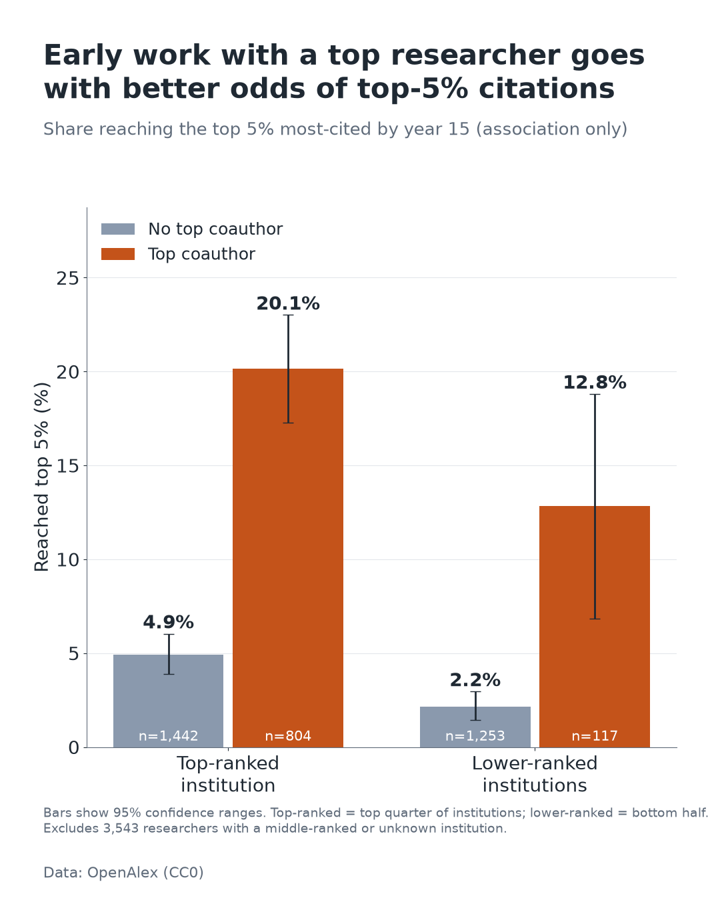

# 01: Early-career signals of top-cited AI researchers

**Question:** Which signals in an AI researcher's first 3 years predict becoming a top-5% cited researcher by year 15, and does coauthoring with a top researcher matter more for people from lower-tier institutions?

**Post:** [LinkedIn](#)

> **Status:** full run completed on 2026-10-21 (7,159 researchers). Results are preliminary and associational; read [limitations.md](limitations.md) first.

## Setup

- Data: [OpenAlex](https://api.openalex.org) (CC0). AI subfield id 1702, works 2008-2011 seed the cohort.
- Method: cohort of authors with first indexed publication in 2008-2011 and >= 2 works in t0..t0+2 (authors who stopped publishing are kept, label 0); target = top 5% by citations over t0..t0+14; features from t0..t0+2 only; logistic baseline + LightGBM; SHAP; model-free 2x2 (top coauthor x institution tier) with bootstrap CIs.
- Seed: 42 | Runtime: API-bound (hours across days, free tier ~$1/day); modeling < 5 min on a laptop CPU.

## Run

```bash
cd sketches/01-early-career-signals            # run all commands from this folder
python -m venv .venv && source .venv/bin/activate      # Windows: .venv\Scripts\activate
pip install -r requirements.txt
export OPENALEX_API_KEY=...        # or put it in a local .env file (gitignored); optional: OPENALEX_MAILTO
python -m src.pipeline --dry-run   # ~300 candidate authors, writes to outputs/dry_run/
python -m src.pipeline             # full run -> results.md, limitations.md, figures/
python -m src.cost                 # total API spend recorded so far
pytest                             # unit + end-to-end tests (no network)
```

The pipeline prints the remaining budget from `/rate-limit`, caches **every** response under `data/cache/` (gitignored), and stops cleanly when the budget drops below `MIN_BUDGET_USD`. Re-run on the next day: cached requests cost nothing, so it resumes where it stopped. Tune cohort size with `CANDIDATE_AUTHOR_CAP` / `SEED_SAMPLE_WORKS` in `src/config.py`.

## Layout

| Path | Purpose |
|---|---|
| `src/api.py` | cached, rate-limited, backoff OpenAlex client + budget guard |
| `src/cohort.py` | seed sampling, stage A (early works), cohort filter, stage B (outcome works) |
| `src/target.py` | citations_15, h-index, top-5% label |
| `src/enrich.py`, `src/features.py` | batched lookups; leakage-free features + data dictionary |
| `src/modeling.py`, `src/explain.py` | temporal split, models, bootstrap CIs, SHAP, 2x2 analysis |
| `src/plots.py`, `src/report.py` | 1080x1350 figures; results.md / limitations.md generators |
| `src/carousel.py` | builds the 14-page LinkedIn PDF from summary.json and the real source code |
| `notebooks/analysis.ipynb` | thin notebook replaying from cache |

## Result

Run date: 2026-10-21. API cost: about $1.7 of OpenAlex free-tier budget (ledger shows $1.32; roughly $0.4 more was spent in earlier partial runs before the ledger was reset), spread over 3 keys / 2 days.

- Cohort: 7,159 AI researchers (358 in the top 5%); train 2008-09 starters, test 2010-11 starters.
- Early signals predict the top 5%: LightGBM AUC 0.83 without early citations (95% CI 0.79-0.87), but PR-AUC only 0.31 vs base rate 0.04.
- Top early coauthor: 15.6 percentage points higher chance of reaching the top 5% (95% CI 12.9-18.1); direction agrees with Li et al. 2019. Part of this is mechanical (shared papers add to the author's own citations).
- Does it matter more at lower-ranked institutions? Not supported: difference-in-differences -4.6 pp (95% CI -10.9 to +2.6), and only 117 lower-ranked researchers had a top coauthor.

Full numbers: [results.md](results.md) and [summary.json](summary.json). Swipeable post: [LinkedIn_carousel.pdf](LinkedIn_carousel.pdf) (`python -m src.carousel`). Figures in `figures/`:



## What this does not show

See [limitations.md](limitations.md) (generated with the results): association not causation, residual survivorship bias, author disambiguation errors, uneven conference coverage, current-h-index approximation, a single field.

## What didn't work

- Dry runs with ~300 candidate authors yield too few top-5% authors to model; the pipeline skips modeling gracefully in that case.
- Stricter "top coauthor before the collaboration" definition: not implemented (needs per-coauthor works counts by year).

## References

- Li, Aste, Caccioli, Livan (2019). Early coauthorship with top scientists predicts success in young careers. *Nature Communications* 10, 5170 (direction check only).
- Priem et al. (2022). OpenAlex. arXiv:2205.01833.
