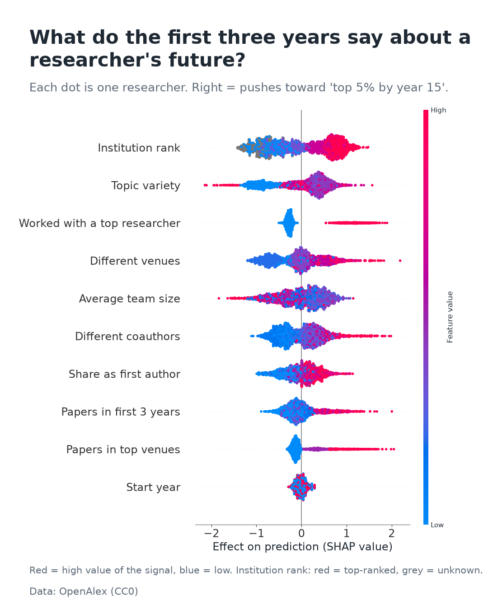
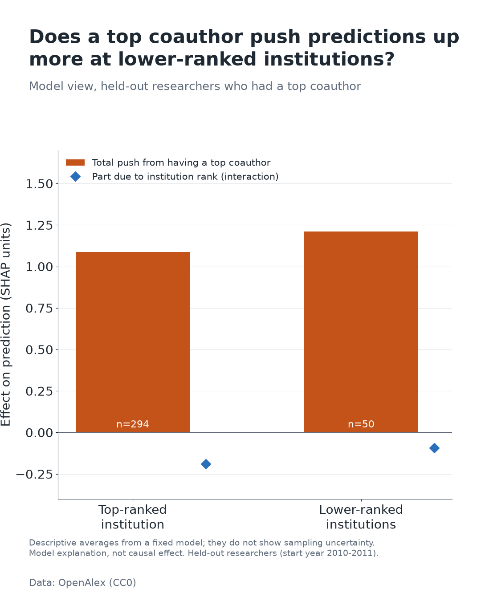
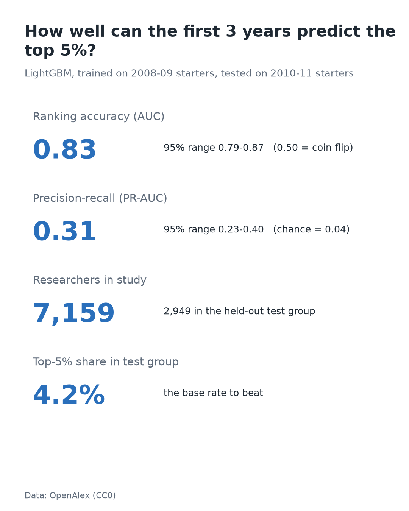

# 01: Early-career signals of top-cited AI researchers

**Question:** Which signals in an AI researcher's first 3 years predict becoming a top-5% cited researcher by year 15, and does coauthoring with a top researcher matter more for people from lower-tier institutions?

**Swipeable PDF for the LinkedIn post:** [LinkedIn_carousel.pdf](LinkedIn_carousel.pdf)
**Author:** Maryam Mahmoudi · [GitHub](https://github.com/maryammahmoudi1993) · [LinkedIn](https://www.linkedin.com/in/maryam-mahmoudi-data-scientist)
**This sketch:** <https://github.com/maryammahmoudi1993/xai-sketchbook/tree/main/sketches/01-early-career-signals>

> **Status:** full run completed on 2026-10-21 (7,159 researchers). Results are **preliminary and associational**. Read [limitations.md](limitations.md) before quoting any number. Every number in this README comes from [results.md](results.md) / [summary.json](summary.json), which the pipeline writes; nothing is hand-edited.

## Table of contents

1. [TL;DR](#tldr)
2. [Results](#results)
3. [How it works](#how-it-works)
4. [Reproduce it](#reproduce-it)
5. [Configuration and budget](#configuration-and-budget)
6. [Project layout](#project-layout)
7. [Outputs](#outputs)
8. [Design decisions and deviations](#design-decisions-and-deviations)
9. [What this does not show](#what-this-does-not-show)
10. [What didn't work](#what-didnt-work)
11. [Troubleshooting](#troubleshooting)
12. [References and license](#references-and-license)

## TL;DR

I followed **7,159 AI researchers** whose first indexed paper appeared in 2008-2011 for 15 years, using only open data ([OpenAlex](https://openalex.org), CC0). A researcher counts as a "success" if their citations over years 0-14 put them in the **top 5% of this cohort** (at least 1,540 citations; 358 researchers).

1. **The first 3 years carry a signal, but not a crystal ball.** A LightGBM model that sees only first-3-year information reaches AUC 0.83 on researchers it never saw, yet precision-recall AUC is only 0.31 against a 0.04 base rate.
2. **Working early with a top researcher goes with better odds**: +15.6 percentage points of reaching the top 5% (95% CI 12.9 to 18.1), robust to adjusting for the other signals. Direction agrees with Li et al. (2019). Part of this link is mechanical (shared papers add to the author's own citations).
3. **No evidence it matters more at lower-ranked institutions**: difference-in-differences -4.6 pp (95% CI -10.9 to +2.6). The interval includes zero and only 117 lower-ranked researchers had a top coauthor, so the data neither support nor rule out the idea.

## Results

Run date: **2026-10-21**. OpenAlex API cost: about **$1.7** of free-tier budget (ledger shows $1.32 over 13,317 network calls; roughly $0.4 more was spent in earlier partial runs before the ledger was reset), across 3 API keys and 2 days.

### Cohort

| Step | Authors |
|---|---|
| Candidate authors (random sample of AI-subfield works 2008-2011, capped) | 40,000 |
| First indexed publication year (t0) in 2008-2011 | 12,610 |
| At least 2 works in t0..t0+2 (**final cohort**) | **7,159** |
| In the top 5% by citations over t0..t0+14 (>= 1,540) | 358 |

Train: researchers with t0 in 2008-09 (n = 4,210). Test: t0 in 2010-11 (n = 2,949, base rate 4.2%). 29.6% of the cohort published nothing after year 3; they stay in the data (label 0).

### Prediction (test cohorts 2010-11)

| Model | Features | ROC-AUC (95% CI) | PR-AUC (95% CI) |
|---|---|---|---|
| Logistic regression | with early citations | 0.904 (0.874-0.929) | 0.514 (0.421-0.602) |
| LightGBM | with early citations | 0.870 (0.829-0.905) | 0.477 (0.381-0.574) |
| Logistic regression | without early citations | 0.871 (0.839-0.901) | 0.332 (0.250-0.420) |
| **LightGBM** | **without early citations** | **0.832 (0.792-0.869)** | **0.314 (0.233-0.399)** |

Base rate (chance PR-AUC): 0.042. `early_citations` overlaps the target, so it is reported with and without. A plain standardized logistic regression is at least as good as LightGBM here; SHAP uses the LightGBM model without early citations.

### Top coauthor x institution tier (model-free, whole cohort)

| Institution group | Top coauthor | n | In top 5% | P(top 5%) (95% CI) |
|---|---|---|---|---|
| Top-ranked | no | 1,442 | 71 | 4.9% (3.9-6.0) |
| Top-ranked | yes | 804 | 162 | 20.1% (17.3-23.0) |
| Lower-ranked | no | 1,253 | 27 | 2.2% (1.4-3.0) |
| Lower-ranked | yes | 117 | 15 | 12.8% (6.8-18.8) |

Gap at top-ranked: 15.2 pp (12.3-18.4). Gap at lower-ranked: 10.7 pp (5.0-17.1). Difference-in-differences: **-4.6 pp (-10.9 to +2.6)**, so "not supported". Overall gap 15.6 pp (12.9-18.1); adjusted log-odds 0.44 (0.34-0.55). 3,543 researchers (middle-ranked or unknown institution) are not in this table.

### Figures (1080x1350, LinkedIn portrait)

| | |
|---|---|
|  |  |
|  |  |

More: [dependence: top coauthor](figures/5_dependence_top_coauthor.png), [dependence: papers in first 3 years](figures/6_dependence_n_papers.png), [calibration](figures/7_calibration.png).

The interaction figure is descriptive only (mean SHAP of a fixed model, without sampling uncertainty). Use the 2x2 table above for statistical statements.

## How it works

```
OpenAlex API ──► seed sample of AI works 2008-2011 ──► candidate authors (40,000, seeded shuffle)
                                   │
        Stage A: all works up to 2013 for each candidate (batches of 50 authors)
                                   │  t0 = first indexed publication year
                 cohort filter:  t0 in 2008-2011  and  >= 2 works in t0..t0+2
                                   │
        Stage B: works 2014-2025 for the cohort ──► citations_15, h-index, top-5% label
                                   │
   lookups: sources, coauthors, institutions ──► features from t0..t0+2 ONLY
                                   │
   temporal split ─► logistic baseline + LightGBM ─► metrics + bootstrap CIs
                                   │
         SHAP / 2x2 bootstrap / Li et al. check ─► figures, results.md, limitations.md, PDF
```

**Cohort.** Authors come from a seeded random sample of OpenAlex works in the Artificial Intelligence subfield (id 1702), years 2008-2011, types `article|proceedings-article`. For each candidate the pipeline downloads all works up to 2013, sets t0 to the first indexed year and keeps authors with t0 in 2008-2011 and at least 2 works in t0..t0+2 (excludes one-off authors). Authors who later stopped publishing are labeled 0, not dropped.

**Target.** `citations_15` is the sum of current `cited_by_count` over works published in t0..t0+14. `label = 1` if it is in the top 5% of the cohort. The h-index over those works is stored as a secondary target.

**Features** (only works from t0..t0+2, so no information from the future; see [data_dictionary.csv](data_dictionary.csv)):

| Feature | Plain-English meaning |
|---|---|
| `n_papers_early` | Papers in first 3 years |
| `early_citations` | Citations to those papers (overlaps the target; run with and without) |
| `n_distinct_venues` | Different journals/conferences |
| `n_top_venue_papers` | Papers in top venues: top 10% of venues by 2-year mean citedness (threshold 4.43) plus a hand-listed set (NeurIPS, ICML, ICLR, CVPR, ICCV, ECCV, AAAI, IJCAI, ACL, EMNLP, TPAMI, JMLR) |
| `has_top_coauthor` | Any early coauthor in the top 5% by current h-index (h >= 55 among 36,444 coauthors); 17.3% of the cohort |
| `n_unique_coauthors`, `mean_team_size` | Collaboration breadth |
| `institution_tier` | Quartile of the author's most frequent early institution by institution h-index (1 top ... 4 bottom, 0 unknown = 32.9%) |
| `topic_diversity` | Shannon entropy of primary topics |
| `first_author_share` | Fraction of early papers as first author |
| `cohort_year` | t0, as a control |

**Models.** Temporal split (train t0 2008-09, test t0 2010-11). Baseline: standardized logistic regression (tier one-hot). Main: LightGBM with `scale_pos_weight` for class imbalance; its scores are Platt-recalibrated on out-of-fold training predictions so the calibration plot is meaningful. Metrics: ROC-AUC and PR-AUC with 1,000-resample bootstrap 95% CIs, plus the positive base rate.

**Explainability.** SHAP TreeExplainer on the test set (beeswarm, dependence plots, interaction values for `has_top_coauthor` x `institution_tier`). Model-free check: P(top 5%) for the 2x2 of top coauthor x institution group (top quartile vs bottom half) with bootstrap CIs and a difference-in-differences. Robustness: an adjusted logistic coefficient for `has_top_coauthor` with a bootstrap CI, compared in direction with Li et al. (2019).

## Reproduce it

Run **everything from this folder** (`sketches/01-early-career-signals`); the modules live in `src/` and are launched with `python -m`.

```bash
git clone https://github.com/maryammahmoudi1993/xai-sketchbook.git
cd xai-sketchbook/sketches/01-early-career-signals

python -m venv .venv
source .venv/bin/activate            # Windows PowerShell: .venv\Scripts\Activate.ps1
pip install -r requirements.txt      # Python 3.11

# an OpenAlex API key is required (free, ~$1 of usage per day)
echo "OPENALEX_API_KEY=your-key" > .env       # gitignored; or export the variable

python -m src.pipeline --dry-run     # ~300 candidate authors -> outputs/dry_run/ (plumbing check only)
python -m src.pipeline               # full run -> results.md, limitations.md, summary.json, figures/
python -m src.carousel               # 14-page LinkedIn PDF from summary.json
python -m src.cost                   # total API spend recorded so far
pytest                               # 19 tests, no network needed
```

**Resumable across days.** Every raw API response is cached as gzip-JSON under `data/cache/` (gitignored, about 200 MB) keyed by a hash of the request (without the key). A re-run replays from disk and spends nothing. When the daily budget is used up the pipeline stops cleanly (`STOPPED (resumable)`); run it again after the reset (00:00 UTC) and it continues. `python -m src.pipeline --from-cache-only` regenerates all outputs from the cache with zero network calls.

**Dry run.** `--dry-run` (or `DRY_RUN=1`) screens about 300 candidate authors. That yields roughly 55 cohort members and too few top-5% authors to model, so the pipeline skips modeling and tells you so. It exists to test the API plumbing end to end cheaply.

**Notebook.** `notebooks/analysis.ipynb` replays the saved outputs (no new API spend).

## Configuration and budget

All knobs are in [src/config.py](src/config.py).

| Setting | Default | Meaning |
|---|---|---|
| `OPENALEX_API_KEY`, `OPENALEX_API_KEY2`, `...3` | none | Keys are used in order; when a key's remaining daily budget falls below `MIN_BUDGET_USD`, the client switches to the next one. Only when all are low does the run stop. |
| `OPENALEX_MAILTO` | author email | Sent as `mailto` with every request |
| `CANDIDATE_AUTHOR_CAP` | 40,000 | Candidates screened in a full run (main budget lever) |
| `SEED_SAMPLE_WORKS` | 10,000 | Works sampled per seed year |
| `ECS_MAX_BATCHES` (env) | all | Run a preliminary subset of the first N batches of 50 candidates; later runs without it reuse the cache and only fetch the rest |
| `WORKERS` | 8 | Parallel batch fetches (the run is latency-bound) |
| `MAX_REQ_PER_SEC`, `MIN_BUDGET_USD` | 5, 0.05 | Global rate limit and stop threshold |
| `ECS_DATA_DIR` (env) | `./data` | Where cache and processed tables live |

Before heavy calls the client prints the remaining budget from `/rate-limit`; list calls cost $0.0001 each at the time of the run. Using several free-tier keys to stretch the daily budget is the user's responsibility: check the OpenAlex terms of use first.

## Project layout

| Path | Purpose |
|---|---|
| `src/api.py` | cached, rate-limited OpenAlex client with exponential backoff, budget guard, key rotation |
| `src/cohort.py` | seed sampling, stage A (early works), cohort filter, stage B (outcome works), threaded batch fetch |
| `src/target.py` | `citations_15`, h-index, top-5% label |
| `src/enrich.py` | batched lookups of sources, coauthors, institutions (<= 50 IDs per call) |
| `src/features.py` | leakage-free feature builder, venue matching log, data dictionary |
| `src/modeling.py` | temporal split, logistic baseline, LightGBM, bootstrap CIs, calibration |
| `src/explain.py` | SHAP, 2x2 group analysis, adjusted coauthor effect, Li et al. check |
| `src/plots.py` | the 1080x1350 figures |
| `src/report.py` | writes `results.md`, `limitations.md`, `summary.json` |
| `src/pipeline.py` | orchestration, dry run, cost ledger |
| `src/carousel.py` | builds the PDF; text from `summary.json`, code pages from the real sources |
| `src/cost.py` | prints total spend from `data/cost_ledger.jsonl` |
| `tests/` | unit tests plus an end-to-end run against a fake in-memory OpenAlex |
| `notebooks/analysis.ipynb` | thin notebook replaying saved outputs |

## Outputs

| File | Content |
|---|---|
| [results.md](results.md) | every key number with sample sizes and CIs; the three candidate headline findings ranked by robustness (a finding whose CI crosses the null is marked "not supported") |
| [limitations.md](limitations.md) | correlation vs causation, survivorship, disambiguation, venue coverage, h-index approximation, single field |
| [summary.json](summary.json) | machine-readable key numbers (feeds the PDF) |
| [data_dictionary.csv](data_dictionary.csv) | column names, plot labels, descriptions |
| `figures/` | 4 required figures (2x2 bars, SHAP beeswarm, interaction, metrics card) plus 3 supporting ones |
| [LinkedIn_carousel.pdf](LinkedIn_carousel.pdf) | 14-page swipeable explanation with code excerpts |
| `data/` (gitignored) | API cache, processed feature tables, cost ledger, run logs |

## Design decisions and deviations

- **Seed sampling.** OpenAlex's `sample` parameter with seed 42 draws up to 10,000 works per seed year, so candidate authors over-represent prolific people. The shuffled candidate list is capped at 40,000 for budget reasons.
- **`t0` is the first *indexed* year.** It can be later than the true first publication when older records are missing or an author profile is split.
- **Minimum 2 early works** (documented choice) removes one-off authors; the cohort therefore excludes people who never produced two indexed papers early on.
- **Work types.** `article|proceedings-article` is used to implement "article or proceedings".
- **Stage A reads works up to 2013 only.** Enough to find t0 (<= 2011) and the early window (<= 2013); the longer outcome window is fetched only for the cohort in stage B.
- **Institution tier for LightGBM is ordinal** (0 = unknown, 1 = top ... 4 = bottom); plots recode it so "high = top-ranked" and unknown is grey.
- **Stricter top-coauthor definition not implemented.** The pre-collaboration version (coauthor's works before the collaboration year) would need per-coauthor works counts by year; the shipped version uses today's h-index.
- **Platt recalibration** of the class-weighted LightGBM scores uses 3-fold out-of-fold training predictions only (no test leakage).
- **Bootstrap intervals** resample researchers independently and ignore that coauthored papers link researchers.

## What this does not show

See [limitations.md](limitations.md) for the generated, number-filled list. In short:

- **Association, not causation.** Strong researchers pick strong groups and vice versa; nothing here estimates a causal effect of a coauthor.
- **Mechanical overlap.** Papers written with a highly cited coauthor add to the author's own citations, which builds part of the top-coauthor link into the target.
- **Remaining survivorship bias** (careers with fewer than 2 indexed early papers are invisible), **author-disambiguation errors**, **uneven conference coverage** (ICML, ICLR, CVPR, ICCV, ECCV, AAAI, IJCAI and ACL did not match any OpenAlex source in the cohort; NeurIPS, EMNLP, TPAMI and JMLR did), **current-h-index approximation**, and **current citation totals** (earlier papers had more time to be cited).
- **One field, one database.** No claim beyond AI as indexed by OpenAlex; the top-5% label is relative to this cohort.
- **Small cells.** The lower-ranked + top-coauthor cell has 117 researchers (15 in the top 5%).
- 32.9% of researchers have no institution; 3,543 are outside the 2x2.

## What didn't work

- Dry runs with about 300 candidate authors yield too few top-5% authors to model; the pipeline skips modeling gracefully in that case.
- The first full run fetched author batches sequentially and was latency-bound (183 of 800 batches in 15 hours); threading the batch fetches fixed that.
- The first budget parser read `credits_remaining` (9,904 "credits") as dollars; it now reads `daily_remaining_usd`.
- The first interaction figure plotted tiny cells (12-19 researchers) with a noisy "unknown" point and contradicted the model-free result; it was replaced by a group-level descriptive plot.
- Several conferences cannot be matched in OpenAlex, so the hand-listed venue set mostly adds journals.

## Troubleshooting

| Symptom | Fix |
|---|---|
| `No module named 'src'` | You are in the wrong folder. `cd sketches/01-early-career-signals` first. |
| `Set the OPENALEX_API_KEY environment variable` | Create `.env` in this folder or export the variable. |
| `STOPPED (resumable)` | Daily budget used up on all keys. Re-run after 00:00 UTC; nothing is lost. |
| Dry run says "Not enough positives" | Expected for ~300 authors; run the full pipeline. |
| Numbers differ slightly from this README | OpenAlex data changes over time (new citations, merged authors). Cached responses from the 2026-10-21 run give identical results. |
| Windows pytest temp-dir `PermissionError` | `pytest.ini` already points `--basetemp` into the project. |

## References and license

- Li, Aste, Caccioli, Livan (2019). *Early coauthorship with top scientists predicts success in young careers.* Nature Communications 10, 5170 (direction check only).
- Priem, Piwowar, Orr (2022). *OpenAlex: A fully-open index of scholarly works, authors, venues, institutions, and concepts.* arXiv:2205.01833.
- Lundberg & Lee (2017). *A unified approach to interpreting model predictions* (SHAP). NeurIPS.
- Data: OpenAlex, CC0. Code: see the repository [LICENSE](../../LICENSE).
